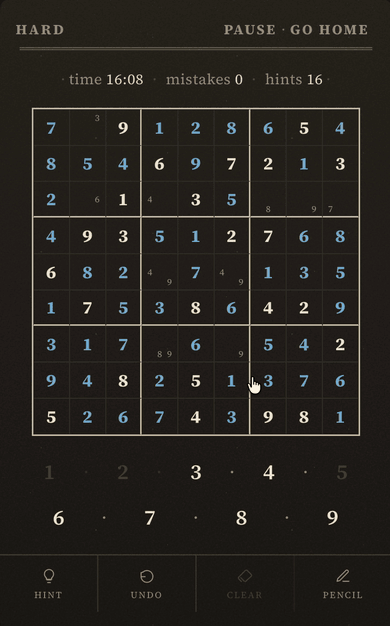
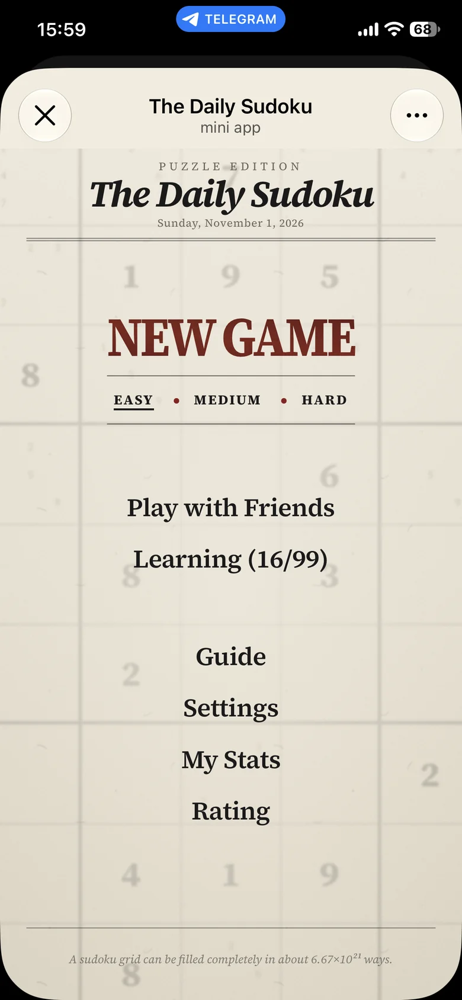
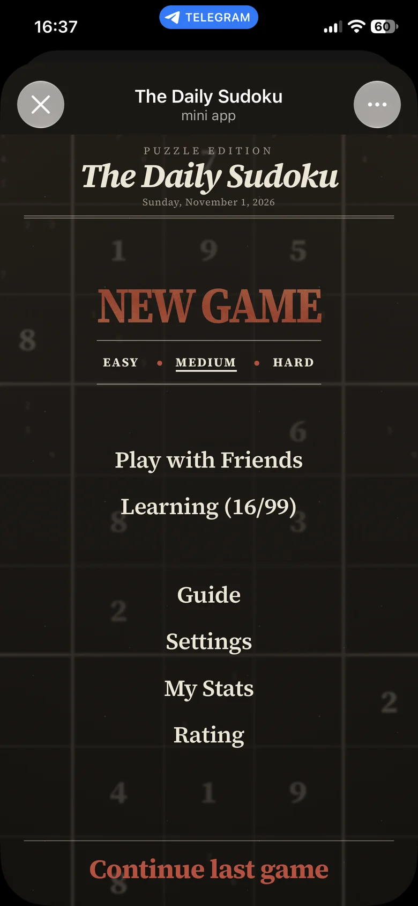
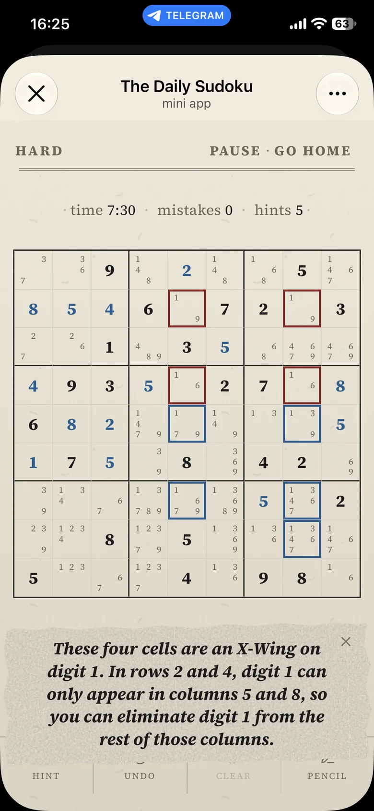
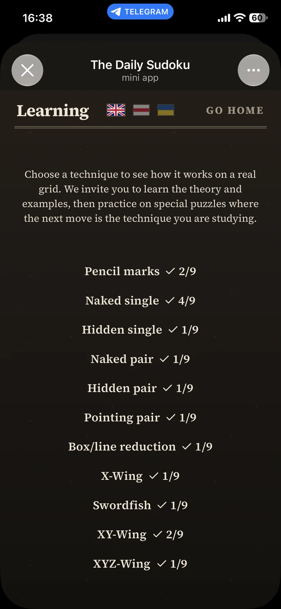
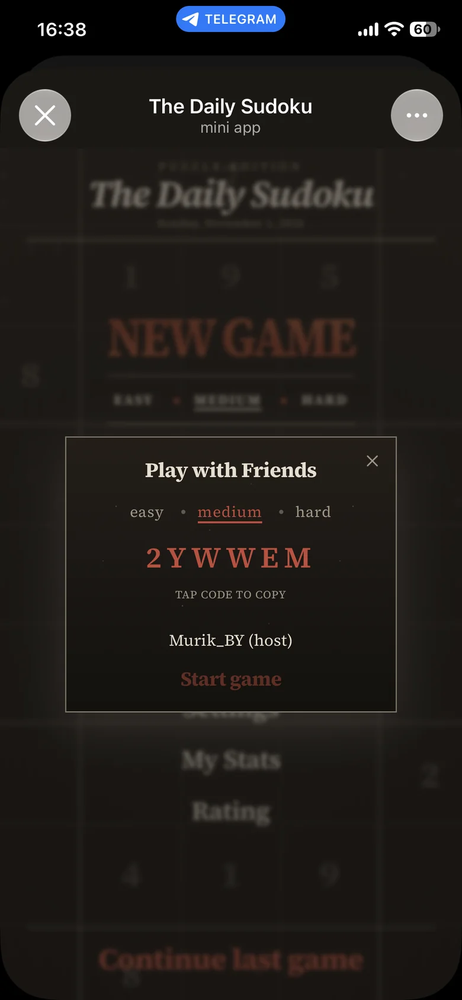
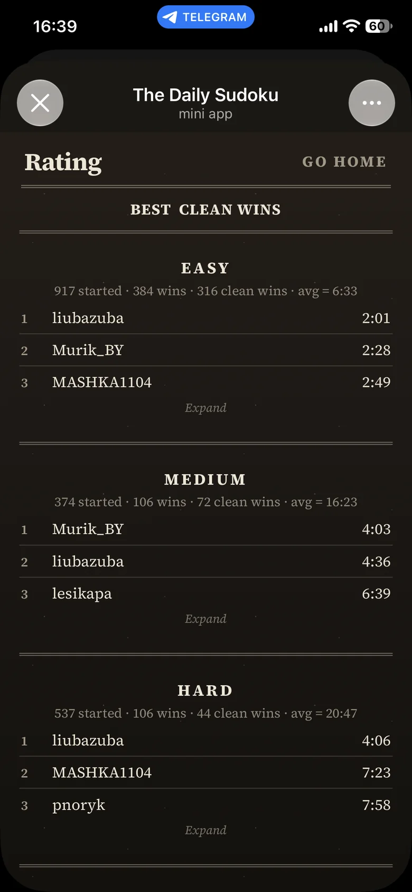
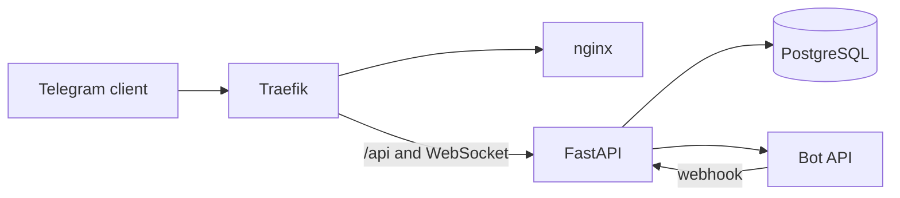

# The Daily Sudoku

Open it in [Telegram](https://t.me/sudoku_mbot).

You can solve a puzzle alone, or with friends. In a party everyone receives the same puzzle and plays it on their own screen.

Difficulty is a grade of the whole solving path. The grade weighs the hardest technique on that path, the number of medium and hard steps, and the length of the path. Easy uses the naked single and hidden single techniques. Medium adds naked pair, hidden pair, pointing pair, and box/line reduction. Hard adds X-Wing, Swordfish, XY-Wing, and XYZ-Wing. [Learning](docs/LEARN.md) shows each technique on a board.

The coach and the learning mode use the same technique scan. In a regular game the coach explains the next step. The learning mode teaches the techniques in order, from pencil marks through XYZ-Wing. You pass a lesson by making that technique's step yourself. A lesson passed with a hint does not count. Lessons do not affect the rating.

A clean win is a finished game with no mistakes and no hints. The player rating is built from clean wins, and at each difficulty it ranks players by their best time.

A game can be opened as a review. The review replays every move on the board. Play from current move starts an analysis from the position on screen: a new game on that position, leaving the reviewed game unchanged.

More than a thousand games were played in the first month.

  

  

## In the code

FastAPI, SQLAlchemy 2 async, PostgreSQL 16, aiogram 3, React 19, TypeScript, Tailwind 4, Docker Compose, and GitHub Actions.

- One technique list rates a puzzle and tells the coach what to say next. See [ENGINE.md](docs/ENGINE.md).
- The generator fills a grid, then carves clues out of it. A technique scan rates what remains. The bitmask solver is the fast counter used while carving. On a 2 vCPU host, `count_solutions` on the shallow hard case takes 7.9 ms, and hard generation takes about 1 s. See [ENGINE.md](docs/ENGINE.md).
- Sign-in is Telegram `initData`, checked with HMAC. The party WebSocket takes a one-time ticket and never puts `initData` in the URL. See [SECURITY.md](docs/SECURITY.md).
- Party play opens a lobby, then gives every member a game on the same puzzle. See [ARCHITECTURE.md](docs/ARCHITECTURE.md).
- The interface is a paper gazette: warm paper, a serif, and thin rules. Tokens are in [DESIGN.md](docs/DESIGN.md).

## Architecture

How a request moves is in [ARCHITECTURE.md](docs/ARCHITECTURE.md).

## Tests and CI

CI runs lint, types, and tests for the backend and the frontend. It applies the database migrations before the backend tests and builds both Docker images. The commands are in [`.github/workflows/ci.yml`](.github/workflows/ci.yml).

## Limits

The API runs as one process. It holds the open party connections, the one-time tickets, and the refill loop. Puzzle generation runs in a child process. See [DECISIONS.md](docs/DECISIONS.md) and [SECURITY.md](docs/SECURITY.md).

## License

All rights reserved. Published to be read. Any other use needs written permission. See [LICENSE](LICENSE). Questions: [t.me/Murik_BY](https://t.me/Murik_BY).
