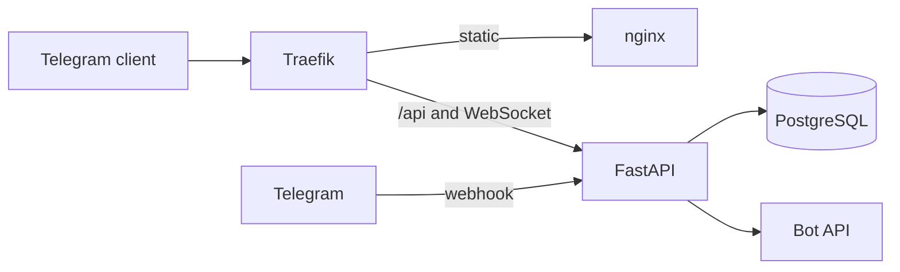
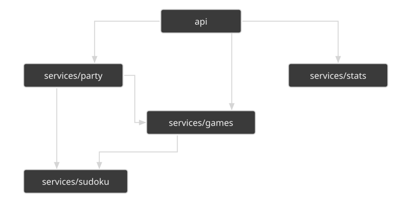
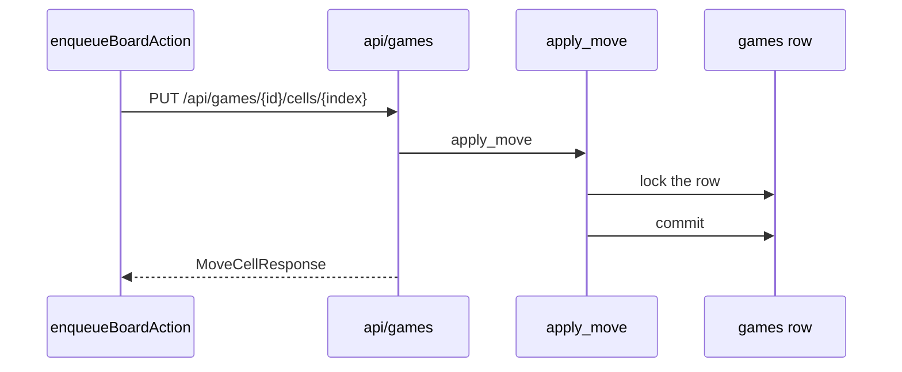
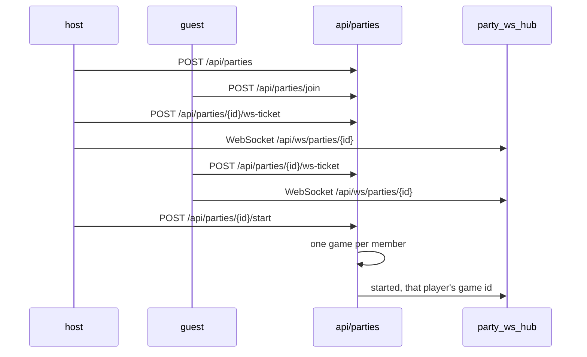
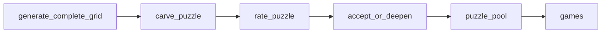
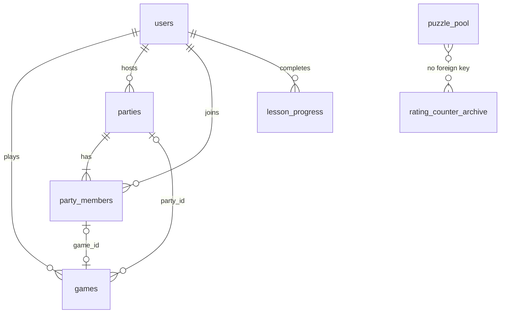

# Architecture

The Mini App is a React client. The API is FastAPI. How a screen looks is in [DESIGN.md](DESIGN.md). How lessons behave is in [LEARN.md](LEARN.md).

## Request path

HTTP calls send Telegram `initData` in the `X-Init-Data` header. `parse_and_validate` checks the HMAC with `compare_digest` and rejects `auth_date` older than 24 hours or more than 60 seconds in the future.

The party WebSocket does not take `initData`. The client asks for a ticket, then connects to `/api/ws/parties/{party_id}` with that ticket as a query parameter. `consume` removes the ticket, so it works once, and it expires after 30 seconds. The `members`, `started`, and `cancelled` events on that socket are schemas in the OpenAPI document. A member who leaves has their socket closed before the others get `members`. A cancelled lobby gets `cancelled`, and then every socket in it is closed. Both closes use code 1000.

A router in `api/` calls a function in `services/`. Services raise the categories in `services/errors.py`. `api/errors.py` turns each category into one HTTP status. HTTP routers do not catch those errors. The party WebSocket route catches a rejected ticket and a non-member, and closes with code 4401. Request and response models live in `schemas/`. Rows live in `models/`.

Starting a game or a party takes a ready puzzle from `puzzle_pool`. The API does not generate one during that request. Why the pool is there is in [Pre-generated puzzles](DECISIONS.md#pre-generated-puzzles). A lesson and an analysis do not use the pool. One player can take 6 puzzles in 60 seconds, across new games and party starts. The next take is rejected with HTTP 429. The counter lives in this process. See [SECURITY.md](SECURITY.md).

## Backend packages

- `services/games/` – one player's board: create, move, notes, undo, hint, review, lessons, and analysis.
- `services/stats/` – scored totals and the clean-best rating.
- `services/party/` – the lobby, the start, and the responses.
- `services/sudoku/` – the grid engine. Technique iterators live in `technique_steps.py`.

## Frontend state

`App` holds one `ScreenState`, reduced by `screenReducer` in `hooks/screenState.ts`. The play screen is one variant of that union.

Board changes go through `enqueueBoardAction` in `hooks/useGame.ts`. The calls run one after another. While one is running, both the move and the notes count as pending.

## System context

Traefik sends `/api`, including the party WebSocket, to FastAPI, and every other path to nginx. uvicorn speaks WebSocket through the `websockets` package, with `--ws websockets-sansio` in `entrypoint.sh`. nginx serves the built client. Telegram posts bot updates to `/api/telegram/webhook`. FastAPI calls the Bot API. When a game is completed, the request reads who gets a message: the other party members, and the player pushed out of the Top 10. The messages go out after the response, so a restart drops the ones not sent yet.

## Backend layers

`api` calls `services/games`, `services/stats`, and `services/party`. `services/party` calls `services/games` and `services/sudoku`. `services/games` calls `services/sudoku`. Those packages also import `schemas/` and `models/`. Nothing in `services/` imports `api/`. The diagram draws the calls, not the shared imports.

## One board move

`enqueueBoardAction` sends one board call at a time. The cell route is `PUT /api/games/{id}/cells/{index}`. `apply_move` locks that `games` row with `SELECT FOR UPDATE`, writes the grid, and commits.

## Party start

The host creates a lobby with `POST /api/parties`. A guest joins with `POST /api/parties/join`. Each client asks for a ticket at `POST /api/parties/{id}/ws-ticket`, then opens `/api/ws/parties/{id}`. `POST /api/parties/{id}/start` takes one puzzle from the pool, inserts one `games` row per member, and the hub sends that player their own game id. Create, join, and start also require the play lock. Leaving a waiting membership locks the party row and re-checks `waiting`. A party that has already started keeps the member. When a lobby starts, every in-progress game of each member becomes `abandoned`, including a solo game.

## Engine pipeline

`generate_puzzle` builds a full grid and carves givens. `accept_or_deepen` rates that puzzle and digs further when the grade is short of the difficulty. The arrow below is that order. The call raises `RuntimeError` when the time budget or the attempt cap runs out. The refill worker runs that call and stores the result in `puzzle_pool`. Starting a game or a party copies a row from that pool. A lesson and an analysis do not.

## Data model

A solo game has no `party_id`. `party_members.game_id` stays empty until the party starts. `puzzle_pool` and `rating_counter_archive` have no foreign keys. The dotted line only keeps both tables on the diagram.

JSONB columns:

- `games.notes` maps a cell index to its pencil digits.
- `games.undo_stack` is a list of entries. Each entry holds `index`, `previous_value`, and `previous_notes`.
- `games.events` is a list of `set`, `clear`, `notes`, and `hint` events.
- `games.assists` and `parties.assists` hold the eight assist flags.
- `users.preferences` holds `difficulty`, `assists`, and `custom_assists`.

`rating_counter_archive` has one row per difficulty: `games_started`, `games_completed`, `clean_wins`, and `clean_elapsed_sum`.

## Single instance

`party_ws_hub`, `party_ws_tickets`, the broadcast drafts in `bot/broadcast.py`, the pool take counters, and the Top 10 drop cooldown live in this process. The pool refill and its worker process do too: the worker is a child of this process. A second API process would not see the hub, the tickets, the drafts, the pool take counters, the drop cooldown, or that worker.
