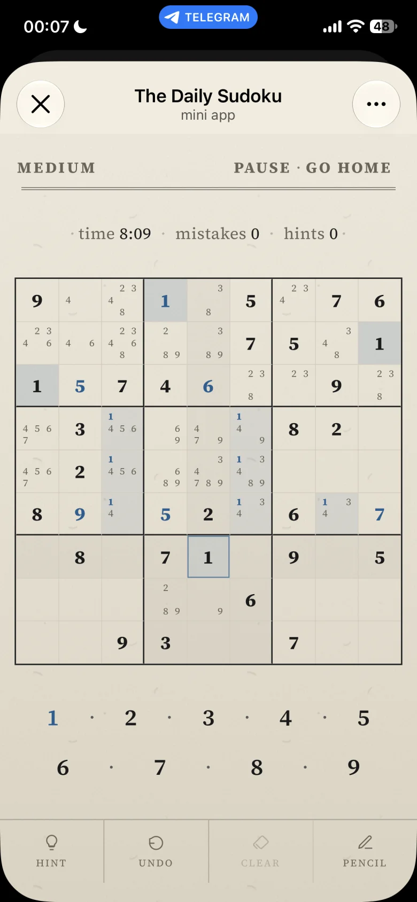

# Design

The interface is a paper gazette: warm paper, a serif, and thin rules. The tokens in `frontend/src/styles/tokens.css` are the contract. `frontend/src/index.css` loads Tailwind, `tw-animate-css`, the font files, then `tokens`, `gazette`, `home`, `guide`, `lesson`, `party`, `play`, and `stats`. `main.tsx` imports `index.css` only.

The play screen: givens, entered digits, pencil marks, and the number pad.

  

## Paper

`:root` (also `[data-theme="gazette"]`) and `html.dark`:

| Token | Light | Dark |
|---|---|---|
| `--background` | `#f3ecdf` | `#1c1814` |
| `--foreground` | `#1a1a1a` | `#e8dfd0` |
| `--card` | `#f6efe3` | `#241f19` |
| `--primary` | `#8b1e1e` | `#c44a3a` |
| `--play-accent` | `#1d5f91` | `#7eb3d4` |
| `--muted-foreground` | `#6b6458` | `#a39888` |
| `--border` | `#c9c2b5` | `#4a4338` |
| `--ink` | `#1a1a1a` | `#efe6d6` |
| `--rule` | `#2a2a2a` | `#cfc4b0` |

The paper surface:

| Token | Light | Dark |
|---|---|---|
| `--paper-top` | `#f3ecdf` | `#241e18` |
| `--paper-mid` | `#ebe4d6` | `#1c1814` |
| `--paper-bottom` | `#e0d7c6` | `#14110e` |
| `--paper-line` | `#d4cdc0` | `#3a342c` |
| `--paper-grain-opacity` | `0.16` | `0.28` |

`--paper-wash` is a vertical gradient from `--paper-top` through `--paper-mid` (48%) to `--paper-bottom`. `--paper-grain` is an inline SVG; the dark block keeps that image and sets `--paper-grain-blend` to `overlay` (light uses `multiply`). The dark block replaces `--paper-flecks`.

## Type

Source Serif 4 is `--font-sans`, `--font-display`, and `--font-mono`, with `"Times New Roman", serif` after it. Weights 400, 400 italic, 600, 700, and 700 italic are imported in `index.css`.

IBM Plex Sans (400 and 600) is the second face. Literal `"IBM Plex Sans"` declarations, with `ui-sans-serif, system-ui, sans-serif` after them, sit on `.gazette-stats-percent`, `.gazette-coach-card-warn .gazette-coach-card-text`, and `.gazette-coach-card-strengthen`.

## Radius

`--radius` is `0.25rem`. The `@theme` radii are `--radius-sm: 0.15rem`, `--radius-md: 0.25rem`, `--radius-lg: 0.35rem`, and `--radius-xl: 0.5rem`.

## Dark mode

Dark mode is the `dark` class on `html`. `@custom-variant dark` matches `&:is(.dark *)`. `html.dark` sets `color-scheme: dark`.

Settings stores `light`, `dark`, or `auto`. `auto` follows `appearanceSchedule.ts`: dark from 18:00 until 08:00. That choice is applied when `applyAppearanceTheme` runs, at launch and when the player changes Settings. No timer flips the theme while the app stays open.

## Class names

The stylesheets use `.gazette-*` together with the older prefixes `.home-*`, `.sudoku-*`, `.party-*`, and `.guide-preview-*`.
